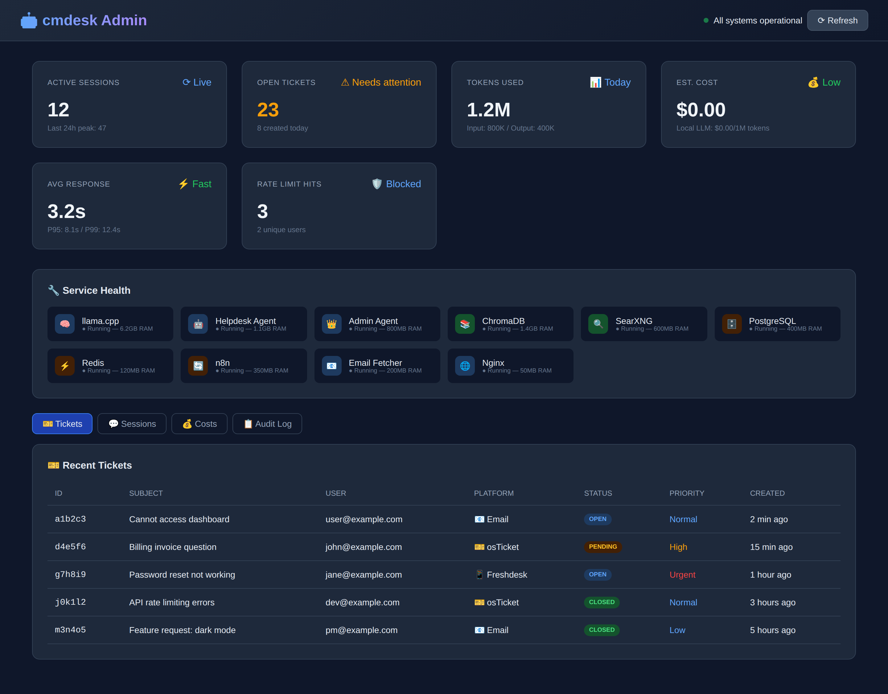
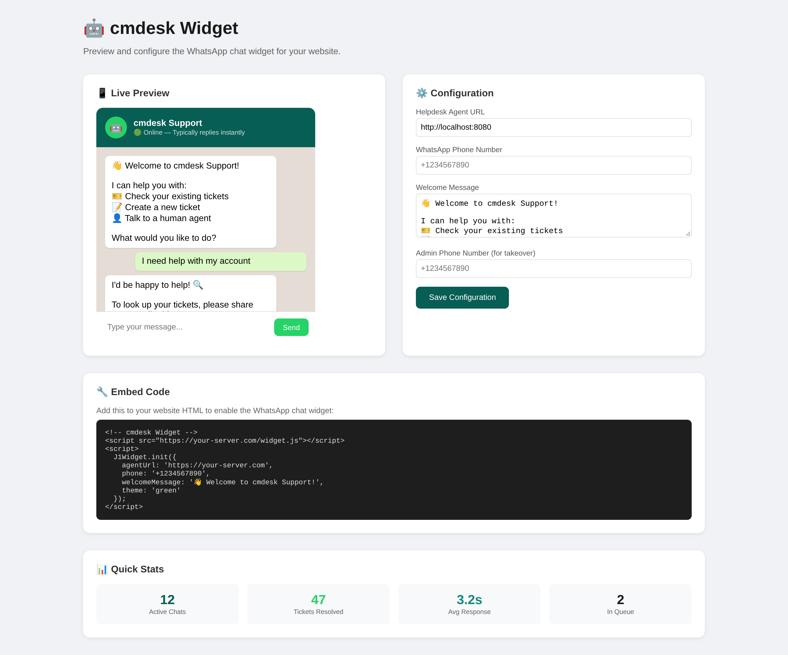

<p align="center">
  
</p>

# cmdesk

> Self-hosted AI helpdesk agent: ingests email, chat, WhatsApp, and tickets into one queue, answers from your knowledge base with a local LLM, and tracks the per-ticket AI cost in real time.

Formerly CommandDesk.

[](https://github.com/OneByJorah/cmdesk/actions/workflows/ci.yml)
[](https://github.com/OneByJorah/cmdesk/blob/master/LICENSE)
[](https://github.com/OneByJorah/cmdesk)
[](https://github.com/OneByJorah/cmdesk/stargazers)
[](https://github.com/OneByJorah/cmdesk/pkgs/container/cmdesk)



## Why This Exists

Helpdesk AI is usually a paid SaaS add-on that ships your ticket data off-premises. cmdesk runs the pipeline on your own machine: it ingests email and chat into a unified queue, answers from your own knowledge base using a local llama.cpp model (or the OpenAI API), and tracks the AI cost of every ticket. Humans can take over any conversation at any point, and n8n workflows handle routing, escalation, and satisfaction surveys.

## Features

- Multi-platform queue: email (IMAP), web widget, WhatsApp webhook, osTicket, Freshdesk, and Zammad.
- AI replies via a local llama.cpp server or the OpenAI API, with a system prompt you control.
- ChromaDB vector search over your own documentation, plus SearXNG web search.
- Per-session rate limiting with an audit-friendly session store in Redis.
- SLA definitions with automatic escalation on breach.
- n8n workflow automation for routing, escalation, surveys, and digests.
- Admin dashboard with live queue, metrics, service health, and cost cards.

## Quick Start

Verified on Linux with Docker Compose v2. Every command below was run on a clean clone.

```bash
git clone https://github.com/OneByJorah/cmdesk.git
cd cmdesk
cp .env.example .env        # demo defaults; change secrets before exposing anything
docker compose up -d --build
curl -fsS http://127.0.0.1/healthz   # → {"status":"ok"}
```

Open the dashboard at <http://127.0.0.1/dashboard/>.

All services bind to `127.0.0.1` only. Default ports:

| Service | URL |
| --- | --- |
| Admin dashboard (nginx) | <http://127.0.0.1/dashboard/> |
| Widget preview (tools-ui) | <http://127.0.0.1:8484/> |
| Helpdesk agent API | <http://127.0.0.1:8080/> — OpenAPI at `/docs`, health at `/healthz` |
| Admin agent API | <http://127.0.0.1:8082/healthz> |
| WhatsApp webhook | <http://127.0.0.1:9090/webhook/whatsapp> |
| n8n | <http://127.0.0.1:5678/> |
| SearXNG | <http://127.0.0.1:8888/> |
| ChromaDB | <http://127.0.0.1:8000/api/v1/heartbeat> |
| llama.cpp server | <http://127.0.0.1:8081/health> |

If a port is busy on your host, override it in `.env` — `AGENT_PORT`, `ADMIN_AGENT_PORT`, `LLAMA_PORT`, and `SEARXNG_HOST_PORT` are honored by `docker-compose.yml`.

Stop and clean up:

```bash
docker compose down -v
```

## Demo Mode (What Works Out of the Box)

The stock `.env` is a working **demo configuration**, not a production one:

- **No model is bundled.** Put a GGUF file at `models/qwen2.5-7b-instruct-q4_k_m.gguf` (or change `LLAMA_ARG_MODEL` in `docker-compose.yml`) and restart the `llama` service; it loads automatically. Without a model the llama.cpp container idles (and stays healthy) so the rest of the stack starts, and `POST /chat` replies with a canned "having trouble" message instead of an LLM answer. Rate limiting, sessions, and the dashboard all work regardless.
- **Email ingestion idles.** With `IMAP_HOST=imap.example.com` the fetcher logs connection errors and retries; set real IMAP credentials in `.env` to activate it.
- **WhatsApp needs a token.** The webhook receiver serves `:9090` and answers the verification handshake, but outbound replies require `WHATSAPP_TOKEN` and `WHATSAPP_PHONE_NUMBER_ID`.
- **Integrations are inert until configured.** osTicket/Freshdesk keys and n8n workflows are wired but unused with demo values.
- The dashboard screenshots in this README are captured from the running stack with demo data (`user@example.com` and friends); the capture script refuses to save a screenshot if it finds a real-looking IP or email.

## Screenshots



WhatsApp-style widget preview and embed snippet served by the `tools-ui` container on port 8484.

## Architecture

```text
          User (WhatsApp / Web Widget / Email / API / Portal)
                              │
                    Helpdesk Agent (FastAPI :8080)
                    Session Mgmt · Rate Limiting · Routing
                     │          │               │
              ┌──────┴───┐  ┌───┴──────┐  ┌─────┴────────────┐
              │ LLM Core │  │ Context  │  │ Ticket Platforms │
              │llama.cpp │  │ChromaDB  │  │osTicket·Freshdesk│
              │ / OpenAI │  │· SearXNG │  │· Zammad · Email  │
              └──────────┘  └──────────┘  └──────────────────┘
                     │                            │
              Admin Dashboard              n8n Workflows
              PostgreSQL·Redis             Escalation·Surveys
```

## Configuration

`.env.example` documents every variable. The ones the compose file reads:

| Variable | Default | Purpose |
| --- | --- | --- |
| `AGENT_PORT` | `8080` | Host port for the helpdesk agent (127.0.0.1) |
| `ADMIN_AGENT_PORT` | `8082` | Host port for the admin agent (127.0.0.1) |
| `LLAMA_PORT` | `8081` | Host port for llama.cpp (127.0.0.1) |
| `SEARXNG_HOST_PORT` | `8888` | Host port for SearXNG (127.0.0.1) |
| `DB_PASSWORD` / `REDIS_PASSWORD` | demo values | Change before any non-local use |
| `CHROMA_AUTH_TOKEN` | demo value | ChromaDB auth token |
| `JWT_SECRET` | demo value | n8n JWT secret |
| `IMAP_HOST` / `IMAP_USER` / `IMAP_PASSWORD` | `imap.example.com` placeholders | Email ingestion |
| `RATE_LIMIT_PER_SESSION` | `50` | Requests allowed per session per hour |

## Installers

- Linux/macOS: [`install.sh`](install.sh) — wraps the Quick Start.
- Windows: [`install.ps1`](install.ps1) — **Windows-only PowerShell script**; requires Docker Desktop and PowerShell 5.1+. It runs the same compose flow and is not tested on other platforms.

## Development

```bash
make help              # list targets
make start-infra       # postgres, redis, chroma, searxng, n8n, nginx only
make start-agents      # llama + helpdesk/admin agents
node scripts/screenshots.mjs   # capture docs/screenshots against a running stack
```

CI runs `docker compose config`, `hadolint`, `flake8`, YAML checks, and a compose build + postgres/redis smoke test (see [`.github/workflows/ci.yml`](.github/workflows/ci.yml)).

## Stack

Python 3.11 · FastAPI · llama.cpp · ChromaDB · PostgreSQL · Redis · SearXNG · n8n · nginx · Docker Compose.

## Contributing

See [CONTRIBUTING.md](CONTRIBUTING.md) and [CODE_OF_CONDUCT.md](CODE_OF_CONDUCT.md). [Open an issue](https://github.com/OneByJorah/cmdesk/issues).

## License

MIT — see [LICENSE](LICENSE).
